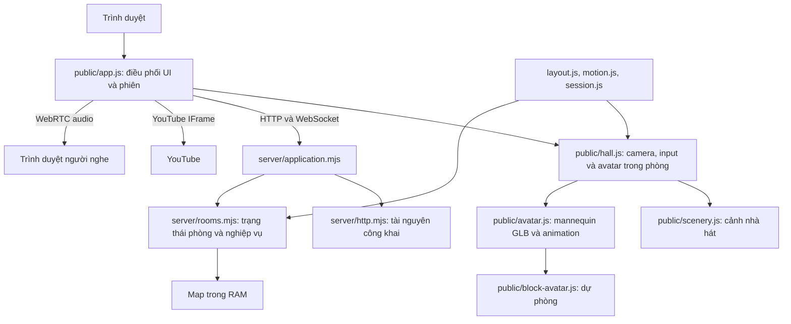

# Đánh giá kiến trúc và khả năng mở rộng

Đánh giá theo mã nguồn thực tế trong thư mục dự án, cập nhật ngày 14/11/2026.

## Kết luận

Khung hiện tại phù hợp để tiếp tục phát triển demo/MVP trên **một tiến trình Node.js**. Sau khi tách phần cảnh, avatar, cấu hình, HTTP và nghiệp vụ phòng, các hướng thay nhân vật, thêm chuyển động và sửa bố cục nhà hát đã có điểm sửa rõ ràng.

Chưa đủ cơ sở để gọi đây là nền tảng production nhiều người dùng: chưa có xác thực, lưu trữ bền vững, giới hạn lưu lượng theo người dùng, heartbeat ứng dụng, đo tải hoặc vận hành nhiều máy chủ. Các giới hạn này là công việc tiếp theo, không phải tính năng đã triển khai.

## 1. Sơ đồ thành phần



## 2. Cấu trúc thư mục

```text
karaoke/
├── server.mjs                 Điểm khởi động và dừng máy chủ
├── server/
│   ├── application.mjs        Ghép HTTP với WebSocket, vòng đời ứng dụng
│   ├── config.mjs             Đọc/kiểm tra cấu hình từ môi trường
│   ├── http.mjs               Danh sách tài nguyên được phép phục vụ
│   └── rooms.mjs              Người dùng, ghế, bài hát, chuyển động, tín hiệu mic
├── public/
│   ├── index.html, style.css  Khung giao diện và trình bày
│   ├── app.js                 UI, WebSocket, YouTube và WebRTC
│   ├── hall.js                Vòng lặp 3D, camera, input, nội suy avatar
│   ├── scenery.js             Sàn, sân khấu, ghế, màn hình, đèn và trang trí
│   ├── avatar.js              Mannequin GLB, clone bộ xương, chuyển clip
│   ├── block-avatar.js        Avatar hình khối dự phòng khi GLB tải lỗi
│   ├── layout.js              Ghế, biên phòng và va chạm dùng chung
│   ├── motion.js              Tốc độ, hướng di chuyển và timeline nhảy dùng chung
│   ├── session.js             Tên phòng và giới hạn giao thức dùng chung
│   └── assets/
│       ├── mannequin.glb      Mô hình chính + 20 clip nguồn + tư thế ngồi
│       ├── human-motions.json Dữ liệu chuyển động của avatar dự phòng
│       └── README.md          Nguồn asset và quy trình tạo lại
├── tools/                     Tạo GLB, tạo clip dự phòng, kiểm tra cú pháp
├── tests/                     Kiểm thử cấu hình, asset và giao thức
├── docs/                      Hướng dẫn người dùng và phát triển
├── .env.example               Ví dụ cấu hình, không chứa bí mật thực
└── package.json, package-lock.json
```

Ba file dùng chung đang đặt trong `public` để trình duyệt tải trực tiếp và Node.js import cùng một nguồn. Chúng phải thuần JavaScript, không chứa DOM, API Node hoặc bí mật. Không chuyển chúng sang thư mục khác mà chỉ sửa một phía import.

## 3. Nguồn trạng thái và luồng dữ liệu

Máy chủ sở hữu danh sách người tham gia, chỗ ngồi, thứ tự bài, người đang hát, thời điểm bắt đầu bài, trạng thái mic và thời điểm bắt đầu nhảy. Mỗi phòng có `users`, `queue`, `song` riêng trong Map.

Trình duyệt dự đoán di chuyển/nhảy của chính mình để phản hồi nhanh, gửi chuyển động định kỳ và nội suy avatar người khác. Hàm nhảy dùng cùng `jumpAt` và cùng timeline ở hai phía; không cần truyền tọa độ Y từng khung hình. Máy chủ kiểm tra số hữu hạn, biên sân khấu/phòng, ghế và tên gait hợp lệ. Hiện **chưa kiểm tra vận tốc tối đa hay đường đi liên tục**, nên client tùy biến vẫn có thể dịch chuyển xa trong vùng cho phép.

WebSocket chỉ truyền trạng thái và tín hiệu WebRTC; không truyền luồng âm thanh. Người hát gửi audio trực tiếp tới từng người nghe. YouTube phát nhạc tại từng trình duyệt, đồng bộ thời gian định kỳ; không có một luồng audio mix chung trên server.

## 4. Hợp đồng WebSocket hiện tại

Endpoint: `/live?room=ten-phong`, dữ liệu JSON. Kích thước payload tối đa 32768 byte.

| Chiều | `type` | Trường chính và ý nghĩa |
| --- | --- | --- |
| Client → server | `name` | `value`: tên hiển thị, tối đa 24 ký tự |
| Client → server | `move` | `x`, `z`, `yaw`, `pitch`, `gait` |
| Client → server | `jump` | Yêu cầu nhảy; máy chủ cấp `jumpAt` |
| Client → server | `seat` | `index`: chỉ số ghế; `-1` để đứng dậy |
| Client → server | `queue` | `video`: mã YouTube 11 ký tự; `title`: tối đa 80 ký tự |
| Client → server | `next` | `key`: bài hiện tại; chỉ người hát được chuyển lượt |
| Client → server | `mic` | `on`: bật/tắt trạng thái mic; chỉ người hát |
| Client → server | `signal` | `to`, `signal`: SDP/ICE tới người cùng phòng được phép |
| Server → client | `hello` | `id` tạm thời và cấu hình `ice` |
| Server → client | `state` | `users`, `queue`, `song`, `now`: snapshot toàn phòng |
| Server → client | `pose` | `user`: trạng thái chuyển động của một người |
| Server → client | `signal` | `from`, `signal`: tín hiệu kết nối audio |

Chưa có version giao thức, ACK hay lỗi có cấu trúc cho yêu cầu bị từ chối. Khi bổ sung client độc lập hoặc thay đổi schema, nên thêm version và cơ chế trả lỗi trước.

## 5. Những điểm đã cải thiện

- `server.mjs` chỉ khởi động/dừng. `createApplication` cho phép khởi tạo server trên cổng tùy ý trong kiểm thử.
- Mỗi `createRoomService` sở hữu trạng thái riêng, thay cho Map toàn cục gắn với điểm khởi động.
- Tài nguyên công khai có allowlist và MIME rõ ràng cho JavaScript, JSON, GLB; hỗ trợ GET/HEAD, từ chối phương thức khác.
- Tên phòng dùng chung một hàm kiểm tra; tên sai được báo ngay trên giao diện thay vì thử kết nối lại liên tục.
- Origin không hợp lệ không làm văng lỗi URL khỏi bộ xử lý upgrade. Đây không phải cơ chế xác thực.
- Yêu cầu ghế không hợp lệ không còn xóa `jumpAt`, tránh vô tình bỏ qua thời gian chờ nhảy.
- Cảnh tĩnh tách khỏi vòng lặp điều khiển. Mannequin được tải một lần; mỗi avatar có skeleton và material riêng, còn geometry được dùng chung.
- Có cấu hình mẫu, kiểm tra cú pháp, kiểm thử mô hình/skinning và kiểm thử HTTP/WebSocket; metadata yêu cầu Node.js 22+.

## 6. Các giới hạn cần biết trước khi mở rộng

| Hạng mục | Hiện tại | Khi nào cần làm tiếp |
| --- | --- | --- |
| Lưu trữ | RAM; mất phòng/bài chờ khi restart; ngắt kết nối bỏ bài của người đó | Cần lịch sử, tài khoản hoặc khôi phục phiên |
| Bảo vệ phòng | Có tên phòng, chưa có mật khẩu/vai trò/quản trị | Trước khi mở phòng cho người lạ |
| Chống lạm dụng | Có maxPayload và giới hạn hàng chờ; chưa rate limit/heartbeat/capacity | Trước khi mở dịch vụ công khai |
| Nhiều server | Mỗi tiến trình có Map riêng, không đồng bộ | Khi cần nhiều instance hoặc failover |
| Âm thanh | Người hát có một WebRTC peer cho mỗi người nghe | Khi số người nghe làm vượt băng thông/CPU; cần đo và cân nhắc SFU |
| Hiệu năng 3D | Clone skeleton từng người; nhiều mesh, ghế, bóng và đèn | Khi test trên máy yếu hoặc tăng số người |
| Cấu trúc frontend | `app.js` vẫn gộp UI/media/socket; `hall.js` vẫn gộp input/camera/actors | Khi thêm tính năng lớn hoặc nhiều người cùng sửa |
| Trải nghiệm phiên | Kết nối lại tạo id mới; chưa khôi phục ghế/bài chờ | Khi muốn reconnect liền mạch |
| Kiểm thử | Có tự động cho logic/asset/giao thức; chưa có E2E trình duyệt trong repo | Khi cần phát hành thường xuyên |
| Vận hành | Chưa có CI, metrics, lưu log tập trung hay load test | Trước triển khai có yêu cầu ổn định |

20 ghế là số ghế trong bố cục, không chứng minh ứng dụng chịu được 20 hoặc nhiều hơn người dùng đồng thời. Chưa xác định sức chứa bằng đo tải. URL phòng khác nhau tách trạng thái nhưng không tạo phòng có quyền truy cập riêng.

## 7. Thứ tự mở rộng đề xuất

1. Khi thêm tính năng media: tách `app.js` thành kết nối phòng, voice, player và UI; giữ một nơi sở hữu state.
2. Khi thay nhiều cảnh/avatar: tách tiếp input, camera, actor collection; bổ sung hàm hủy toàn bộ hall khi chuyển trang/cảnh. Hiện `buildHall` dành cho một lần khởi tạo trên trang.
3. Khi cần phiên/tài khoản: thêm lớp lưu trữ sau room service, định danh người dùng ổn định, quy tắc reconnect và kiểm thử di trú dữ liệu.
4. Trước công khai: thêm xác thực/phân quyền, rate limit, heartbeat, kiểm tra chuyển động, giới hạn người/phòng, giám sát và HTTPS/TURN phù hợp.
5. Sau đo tải: quyết định cần tối ưu render, tách audio sang SFU hay chia nhiều máy chủ. Không chỉ tăng số ghế để coi như đã mở rộng hệ thống.

Không cần thêm framework hoặc cơ sở dữ liệu chỉ để thay mannequin hay sửa nội thất; các phần đó đã có module riêng.

## 8. Thay đổi ngoại hình và hướng nhìn

`avatar-settings.js` là cấu hình thuần dùng chung cho server/client: 9 lựa chọn mặt và phép chuẩn hóa yaw. `faces.js` phụ trách ảnh tham chiếu, thumbnail, cache texture; `avatar-head.js` dựng đầu bo tròn độc lập. GLB giữ thân/bộ xương của mannequin và animation, phần đầu cũ được thay ở runtime.

Thông điệp mới client → server: `{type: "appearance", face: 0}` với `face` là số nguyên từ 0 đến 8. Snapshot user thêm `face` và `bodyYaw`. Máy chủ không lấy bodyYaw từ gói move của client; yaw là hướng nhìn 360° riêng. Đổi mặt không đổi vị trí hoặc hướng thân. Hướng đi dùng bodyYaw, nên kéo nhìn quanh không tự quay thân. Khi lên/xuống sân khấu, máy chủ đặt lại hướng thân thích hợp và giữ khuôn mặt đã chọn.
